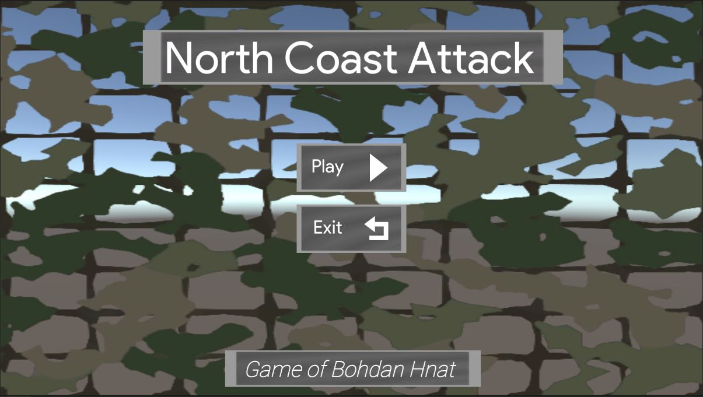
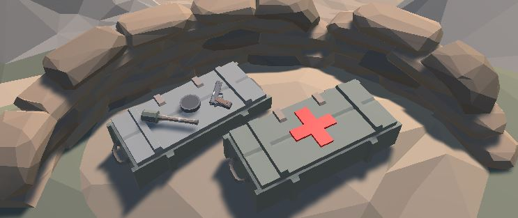

# North-Coast-Attack

## Overview
**North Coast Attack** is a first-person shooter set during the events of World War II.

This project was created as a way to test the implementation of enemy controls and navigation using a state-driven approach, as well as the implementation of several programming and optimization patterns such as `Singleton`, `Object Pool` and interface-based `Service Locator`.

The playable character finds himself on the beach of the first location ("level") and must proceed deeper into the area to encounter various enemies, as well as lootable items.

The current build contains **one playable level** (`Level 1`), reached from the main menu. The combat, weapon, enemy and UI systems are complete and playable end to end, while the multi-level campaign is not yet built.

## Controls

| Action | Input | Implementation |
|---|---|---|
| Move | `WASD` | New Input System action, applied as Rigidbody force |
| Look | Mouse | New Input System action, pitch clamped to ±90° |
| Jump | `Space` | Ground-checked by downward raycast before the impulse is applied |
| Shoot | `LMB` | Hitscan raycast from the camera |
| Aim | `RMB` | Weapon lerps toward a sight position computed from the camera |
| Reload | `R` | Blocked unless the magazine is empty and reserve ammo remains |
| Switch weapon | Mouse wheel | Cycles with wraparound; blocked mid-reload |
| Pick up weapon | `E` | Enabled when a weapon is inside the pick-up sphere |
| Drop weapon | `Q` | Applies forward and upward impulse plus random torque |

Input is captured by `InputService` through the Unity **Input System** package and distributed each frame by `PlayerInputManager`, which keeps input capture separate from the systems that consume it.

## Concept and Outline
* The player is roleplaying as a soldier committed to slaying his enemies. Aim at enemies to kill them.

* The level is populated with enemies carrying different weapons (rifle, submachine gun and machine gun) which gives them different effective ranges, rates of fire and damage output.

* Weapons can be picked up from the ground and from fallen enemies, who drop whatever they were carrying when killed.

* The player can restore his health by finding health restoration means (`med kits`).

* Supply packs (`ammo kits`) found in different places of the location will replenish ammunition.

## Architecture and Patterns

| Pattern | Where implemented | What it does |
|---|---|---|
| **Singleton / Service Locator** | `Context.cs` | A single instance (`_instance ??= new Context()`) exposing `IDataSystem`, `IPlayerBag` and `IAudioSystem`. Systems are reached through interfaces rather than concrete classes, so callers never hold direct references to implementations. Initialised once by `Loading.Awake()`. |
| **Object Pool** | `ObjectPool.cs` | A generic `ObjectPool<T> where T : Transform` with a pre-warm count. Instances are reused by checking `activeSelf` and the pool grows on demand. Used for muzzle particles and bullet trail effects by both the player and every enemy, so no allocation happens per shot. |
| **Component composition** | `HealthComponent`, `MovementComponent` | The same `HealthComponent` serves the player and all enemies; behaviour is attached rather than inherited. |
| **Interface-based damage** | `IDamageble` | Shooting code requests the interface and calls `RegisterDamage`, so anything damageable can be added without touching weapon code. |
| **Event-driven decoupling** | throughout | C# `event Action` is used for `OnDamageDealt`, `OnHealing`, `OnDie`, `onShot`, `onReload`, `onPickedUp`, `onDropped`, `OnWeaponSwitched` and `onAttackingTarget`. The UI, audio and animation layers subscribe to gameplay events instead of polling. |
| **Data-driven configuration** | `WeaponDataStorage` | A `ScriptableObject` holding every weapon's stats, so balance changes are made in the inspector rather than in code. |

## Enemy Behaviour

Each enemy runs a three-state behaviour model, selected every frame by two overlapping `Physics.CheckSphere` tests against the player layer:

| State | Condition | Behaviour |
|---|---|---|
| **Idle** | outside sight range | Destination held at the enemy's own position; movement animation parameters zeroed |
| **Chase** | inside sight range, outside attack range | `NavMeshAgent` destination set to the player; forward-walk animation driven |
| **Attack** | inside both ranges | Agent stopped, enemy rotates to face the player, firing event raised |

Supporting detail:

* Pathfinding uses Unity's **NavMesh**, baked over the level as a `NavMesh Surface` asset.
* Enemies fire with the same data-driven weapon stats as the player, including magazine size, fire-rate gating and a timed reload coroutine.
* Sight and attack radii are drawn with `OnDrawGizmosSelected`, so both ranges can be tuned visually in the editor.
* On death the agent is disabled, a death animation plays, and after a 1.5-second coroutine a corpse prefab is spawned and the enemy object destroyed.
* The dead enemy's weapon is re-tagged, unparented and given back its collider, so it can be picked up by the player.

## Weapons

Four weapons are defined in `WeaponDataStorage.asset`, each a distinct trade-off between damage, range, sustained fire and reload cost:

| Weapon | Damage | Range | Magazine | Fire rate | Reload |
|---|---|---|---|---|---|
| Pistol | 15 | 50 | 10 | 100 | 1.0 s |
| Submachine Gun | 10 | 200 | 30 | 200 | 2.0 s |
| Rifle | 20 | 300 | 5 | 50 | 2.0 s |
| Machine Gun | 10 | 250 | 60 | 250 | 10.0 s |

Firing is **hitscan**: a ray is cast from the camera to the weapon's maximum range, and if the hit object implements `IDamageble` the damage is registered, a blood effect is spawned and an impact sound plays. A pooled muzzle particle and a pooled tracer are spawned at the muzzle, the tracer receiving a forward impulse.

Ammunition is split between the magazine and a reserve carried in `PlayerBag`. Reloading draws a full magazine from the reserve where possible and the remainder otherwise.

## Additional "Core Mechanics"
1. Mouse buttons are used to aim and shoot, the keyboard keys are used to move.
2. During the game, the player can switch between the weapons they are carrying using the mouse wheel.
3. The player can aim down the sights, which moves the weapon to a sight position derived from the camera transform.
4. After killing an enemy, their weapon is dropped on the ground and can be picked up.
5. Weapons on the ground can be picked up with `E` and dropped with `Q`, with physics applied on the drop.
6. Items are placed around the area, so exploring the level is rewarded.
7. Weapon handling is animated throughout (shooting, reloading, aiming in and out), and the held weapon sways with mouse movement.

## Items
* `Med kit` item — restores a configurable amount of health on contact
* `Ammo kit` item — adds to the reserve, cannot exceed the starting carry capacity
* `Weapon` item — picked up from the ground or from fallen enemies

## Win/Loss Conditions
* **LOSS** — the player character dies (the number of health points drops to `0`). A death screen is instantiated, a sound cue plays, and the level reloads after one second.
* **WIN** — a victory condition is not yet implemented. Multi-level objective is planned.

## UI/UX
* The player's current health level is displayed as both a fill bar and a number, driven by events from `HealthComponent` rather than polled each frame. Taking damage lowers it; using a `med kit` raises it.
* The amount of ammunition is displayed as magazine and reserve counts, and follows the player across weapon switches and pick-ups.

* The `Main Menu` offers **Play**, which loads `Level 1`, and **Exit**.

* All registered hits to the enemy and the player are accompanied by visual feedback and sound effects.

* Audio runs through an event-based `IAudioSystem`: gameplay code raises a request by name, and a persistent `AudioSystemManager` resolves the clip and plays it, cross-fading music between menu and gameplay.

## Game Loop
-> Killing enemies on the location using distinct weaponry as well as exploring the area for loot ->
Picking up better weapons from fallen enemies ->
Managing health and ammunition from items found in the area ->

## Planned Development

The following are **not implemented in the current build**. Intended direction rather than as existing features.

* **Multiple locations.** The campaign is designed around three levels; only `Level 1` is built. Level transition and progression logic is planned.
* **Elite enemies ("bosses").** Enemies currently differ by weapon loadout, not by tier. Boss encounters, and gating the next location behind defeating the current one's boss, are not yet present.
* **Weapon modifications.** `WeaponData` currently defines damage, range, magazine size, fire rate, reload time and sound keys. Attachment slots and stat-modifying mods would need new fields and pick-up handling.
* **Win condition.** Nothing currently tracks whether all enemies in a level have been defeated, so the campaign cannot yet be completed.
* **Saving progress.** No save system exists; `DataSystem` holds weapon configuration only.
* **Localisation.** The menu is English-only and contains no language selection.

## Known Technical Issues

* **Editor-only namespaces in runtime scripts.** Five scripts carry stray `using` directives for editor assemblies — `UnityEditor` in `ObjectPool.cs`, `UnityEditor.SearchService` in `HealthComponent.cs`, `UnityEditor.PackageManager` in `EnemyWeaponShooting.cs`, `UnityEditor.Progress` in `WeaponPickUp.cs` and `TreeEditor` in `WeaponSwitch.cs`. These compile in the editor but will fail a player build and need removing.
* **Mixed input handling.** Weapon pick-up and drop read `Input.GetKeyDown` from the legacy Input Manager while everything else uses the Input System package.
* **Per-frame reallocation.** `WeaponSwitch.Update()` rebuilds its weapon array every frame instead of only when the loadout changes.

## Built With

Unity · C# · Unity Input System · NavMesh / NavMeshAgent · ScriptableObjects · TextMesh Pro · SlimUI Modern Menu · Polygon War and Frank RPG Gunslinger asset packs
